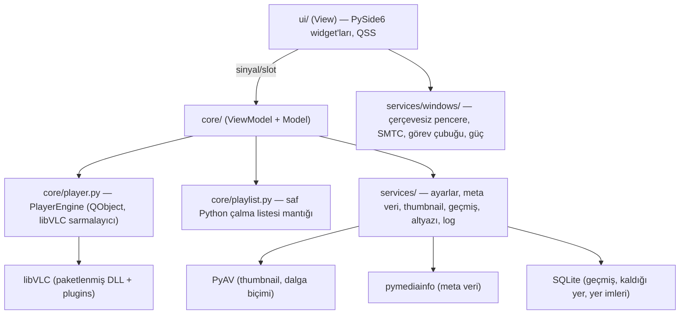

# Lumina Player — Mimari ve Tasarım Sistemi (Aşama 1)

## 1. Motor seçimi: libVLC vs libmpv

| Kriter | libVLC (python-vlc) | libmpv (python-mpv) |
|---|---|---|
| Format/codec kapsamı | Çok geniş (kendi demuxer'ları + FFmpeg) | Çok geniş (FFmpeg) |
| Python bağlaması | Resmî, olgun, ctypes, tek dosya | Topluluk bağlaması, `mpv-2.dll` sürüm uyumu hassas |
| Hazır API'ler | 10 bant EQ + hazır ayarlar, video adjust, iz seçimi, gecikme, snapshot, deinterlace, chapter, ses cihazı listesi | Çoğu özellik property/komut stringleriyle (lavfi filtreleri) |
| Pencereye gömme | `set_hwnd()` — Qt native widget ile sorunsuz | `wid` — o da sorunsuz |
| Windows paketleme | `libvlc.dll` + `libvlccore.dll` + `plugins/` kopyala, bitti | Tek DLL ama build kaynağı/sürümü değişken |
| Lisans | LGPL 2.1+ | LGPL/GPL (derlemeye göre) |

**Karar: libVLC.** Hazır EQ/ayar API'leri, olgun Python bağlaması ve öngörülebilir Windows dağıtımı sayesinde daha az "yapıştırıcı kod" ve daha az risk. libmpv'nin görüntü kalitesi avantajı (gpu-next, shader'lar) bu projenin önceliği değil.

## 2. Katmanlar (MVVM benzeri)



- **UI motoru tanımaz**: Arayüz yalnızca `PlayerEngine` sinyallerini dinler ve metotlarını çağırır. libVLC olayları VLC iş parçacığında gelir → yalnızca Qt sinyali yayınlanır (queued) → ana iş parçacığında işlenir. VLC callback'i içinden asla libVLC çağrılmaz (kilitlenme riski).
- **Saf mantık test edilebilir**: doğal sıralama, tarama, çalma modları, M3U, kodlama tespiti Qt'ye bağımlı değildir → pytest ile test edilir.
- **Uzun işler arka planda**: klasör tarama (QThread), meta veri + thumbnail (QThreadPool, sınırlı eşzamanlılık), dalga biçimi analizi.

## 3. Klasör yapısı

```
OldricMedia/
├─ lumina/
│  ├─ __main__.py            # python -m lumina
│  ├─ app.py                 # QApplication, DPI, tek örnek, log, çökme yakalayıcı
│  ├─ core/
│  │  ├─ vlc_loader.py       # paketli/vendor/sistem libVLC bulucu
│  │  ├─ player.py           # PlayerEngine
│  │  ├─ media_item.py       # MediaItem dataclass
│  │  ├─ formats.py          # uzantı listeleri + içerik (magic byte) tespiti
│  │  ├─ natural_sort.py
│  │  ├─ scanner.py          # klasör tarama
│  │  ├─ playlist.py         # çalma modları, sıra, karışık
│  │  ├─ playlist_model.py   # QAbstractListModel (sanal liste)
│  │  └─ m3u.py              # M3U/M3U8 + JSON içe/dışa aktarma
│  ├─ services/
│  │  ├─ paths.py  settings.py  logger.py  i18n.py
│  │  ├─ metadata.py  thumbnails.py  history.py  subtitles.py
│  │  ├─ single_instance.py
│  │  └─ windows/ (frameless.py, power.py, smtc.py, taskbar.py, file_assoc.py)
│  ├─ ui/
│  │  ├─ theme.py  icons.py  main_window.py  title_bar.py
│  │  ├─ video_widget.py  control_bar.py  seek_bar.py
│  │  ├─ playlist_panel.py  welcome_view.py  audio_view.py
│  │  ├─ settings_dialog.py  dialogs/  widgets/
│  └─ resources/ (icons/*.svg, i18n/tr.json, en.json, app.ico)
├─ tests/
├─ packaging/ (lumina.spec, installer.iss, build.ps1)
├─ tools/fetch_vlc.ps1       # geliştirme için libVLC'yi vendor/vlc'ye kopyalar
├─ vendor/vlc/               # (git'e girmez) libvlc.dll, libvlccore.dll, plugins/
├─ requirements.txt  README.md  .gitignore
```

## 4. Kritik teknik kararlar

| Konu | Çözüm |
|---|---|
| Video üzerinde yarı saydam kontroller | libVLC native HWND'ye çizer; Qt şeffaf widget'ı onun üstüne çizemez. Kontrol çubuğu bu yüzden **ana pencereye ait (owned), çerçevesiz, saydam ayrı bir üst düzey pencere** olarak videonun üstüne konumlanır. |
| Fare/klavye olayları | `video_set_mouse_input(False)`, `video_set_key_input(False)` → olaylar Qt'ye gelir. Otomatik gizleme ayrıca imleç konumu yoklamasıyla (QTimer) güvenceye alınır. |
| Pencere bayrakları | Qt'de bayrak değiştirmek native pencereyi yeniden yaratır ve libVLC HWND'sini koparır. "Her zaman üstte" vb. **Win32 `SetWindowPos`** ile yapılır. |
| Çerçevesiz pencere + Snap Layout | Native `WS_THICKFRAME/WS_CAPTION` korunur; `WM_NCCALCSIZE` ile kenarlık kaldırılır, `WM_NCHITTEST` ile kenar boyutlandırma, başlık sürükleme ve büyüt düğmesi için `HTMAXBUTTON` döndürülür (Win11 Snap Layout menüsü). |
| Instance seviyesindeki VLC ayarları | Altyazı fontu/rengi, ses filtreleri, donanım çözücü gibi ayarlar değişince `PlayerEngine.rebuild()` instance'ı yeniden kurar ve medyayı aynı konumdan sürdürür. |
| Türkçe altyazı | VLC'nin otomatik altyazı bulma kapalı; uygulama aynı adlı altyazıyı bulur, `charset-normalizer` + Türkçe sezgisel ile kodlamayı (UTF-8/1254/8859-9) tespit eder, UTF-8 kopyasını önbelleğe yazıp `add_slave` ile yükler. |
| Thumbnail / önizleme | PyAV (FFmpeg) ile anahtar kareye seek + tek kare çözme, disk önbelleği (`%LOCALAPPDATA%\LuminaPlayer\cache`). |
| Müzik görselleştirme | PyAV + numpy ile arka planda gerçek dalga biçimi ve STFT spektrumu hesaplanır, oynatma zamanıyla senkron çizilir. |
| Kalıcılık | `settings.json` (ayarlar), `library.db` SQLite (geçmiş, kaldığı yer, yer imleri, meta veri önbelleği), `session.json` (son liste + konum). |
| Tek örnek | `QLocalServer`; ikinci örnek argümanlarını gönderip çıkar. |

## 5. Tasarım sistemi

**Renkler (koyu tema)**

| Token | Değer | Kullanım |
|---|---|---|
| `bg.base` | `#0F1115` | Pencere zemini, video arkası |
| `bg.raised` | `#1A1D23` | Başlık çubuğu, yan panel |
| `surface` | `#232730` | Kartlar, giriş kutuları, menüler |
| `surface.hover` | `#2C313C` | Hover |
| `border` | `#2F3440` | 1 px ayırıcılar |
| `text.primary` | `#F2F4F8` | Ana metin (kontrast ≥ 12:1) |
| `text.secondary` | `#A3AAB8` | İkincil metin (≥ 7:1) |
| `text.muted` | `#6B7280` | İpuçları |
| `overlay` | `rgba(15,17,21,0.78)` | Video üstü kontrol paneli |
| `danger` | `#F0525F` | Hata |

**Vurgu renkleri**: Mavi `#3B82F6` · Mor `#8B5CF6` · Kırmızı `#EF4444` · Yeşil `#22C55E` · Turuncu `#F97316`.
Açık tema: `#F5F6F8` / `#FFFFFF` / `#EEF0F3`, metin `#14171C`.

**Tipografi**: Segoe UI Variable → Segoe UI → Inter. Ölçek: 11 (etiket), 13 (gövde), 15 (başlık), 20 (bölüm), 28 (hero).
**Boşluk**: 8 px ızgara (4, 8, 16, 24, 32). **Köşe**: 6 (küçük), 10 (kart/buton), 14 (panel). **Animasyon**: 150–250 ms, `OutCubic`.
**İkonlar**: Lucide stilinde tek tip 24×24, 2 px çizgi SVG; çalışma anında renklendirilir.

**Bileşenler**: `IconButton` (yuvarlak hover), `PrimaryButton` (vurgu dolgulu), `SeekBar` (hover'da kalınlaşan, zaman + önizleme baloncuğu), `VolumeSlider`, `Badge` (720p/1080p/4K), `MediaCard` (thumbnail + ilerleme), `Toast` (hata/bilgi bildirimi), `SidePanel` (kayarak açılan).
